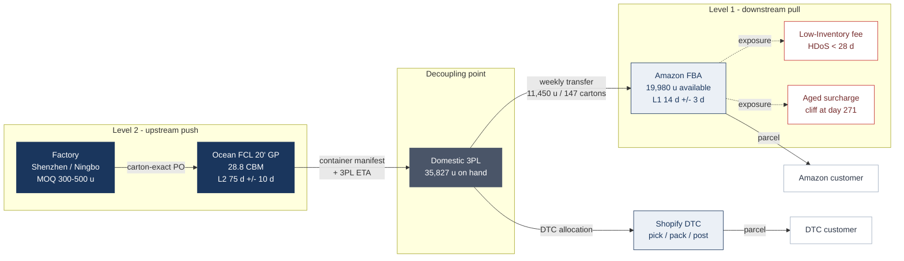
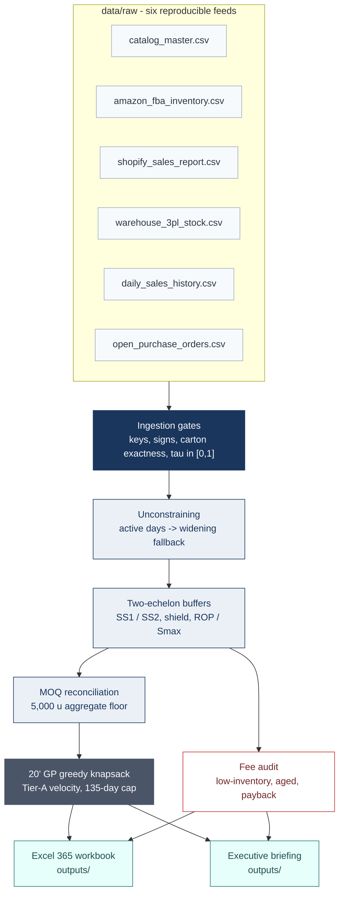

# Omnichannel Multi-Echelon Inventory Allocation & Demand Unconstraining Engine

[](https://github.com/magnumjpg/omnichannel-inventory-control-tower/actions/workflows/tests.yml) [](#) [](https://www.python.org/) [](LICENSE) [](#4-synthetic-data-contract)

**Language:** [Español](README_ES.md) · [Decision record](DECISIONS.md) · [Diagram sources](assets/diagrams/README.md)

**A weekly S&OP engine that decides what true demand is, where stock belongs and what the factory ships - with every constraint auditable.**

*Synthetic 160-SKU catalogue · snapshot 2026-10-25 · seed 42 · USD · one 20' GP weekly ocean cycle · 65 tests*

> **Executive Overview**: End-to-end Sales & Operations Planning (S&OP) engine and multi-echelon inventory replenishment architecture. Models censored demand velocity under stockouts, dynamically optimizes 3PL-to-FBA inventory transfers against Amazon fee tiers, and computes container-optimized purchase orders.

---

## At a glance

- **Question:** what is true demand when stockouts censor sales, how much inventory belongs at FBA versus the 3PL, what should the factory ship, and what should be removed before the aged-inventory cliff?
- **Data:** a deterministic synthetic catalogue of 160 child SKUs in six travel-accessory families (`seed=42`), with the 2026 Amazon fee schedule as a policy input.
- **Method:** censoring-aware demand estimation, two-echelon safety stock with a fee shield, SKU MOQ and container reconciliation, and a removal payback audit; six-tab Excel workbook with 8,048 live formulas.
- **Headline:** 11,450 units (147 cartons) move from 3PL to FBA; the factory PO is 38,750 units (461 cartons, 26.910 CBM); the selected 20' GP loads 28.770 of 28.8 CBM (99.9%) with 41,850 units; worst-case 30-day fee exposure is $3,442.
- **Caveat:** every transaction and balance is synthetic; fee schedules are policy inputs that must be checked against current Amazon tariffs; the workbook needs Excel 365 for `LET`, `XLOOKUP` and `CEILING.MATH`.

This repository implements a weekly S&OP decision engine that answers four operational questions with auditable arithmetic:

1. **What is true demand?** Sales are right-censored by stockouts, so observed units understate demand. A censoring-aware estimator reconstructs latent velocity and is scored on nine walk-forward cutoffs.
2. **How much belongs at FBA versus the 3PL?** Stochastic safety stock is split across two echelons, with a policy shield that keeps FBA above Amazon's 28-day low-inventory fee threshold.
3. **What should the factory ship this week?** SKU MOQs, the 5,000-unit aggregate PO floor, carton granularity and the 135-day DOS cap are reconciled before a 20' GP is filled.
4. **What must be removed or marked down before the aged-inventory cliff?** Removal payback is compared with the monthly aged-inventory surcharge, and only economically justified removals are recommended.

The output is a **six-tab Excel 365 sign-off workbook driven by the engine, with live arithmetic**, a Markdown executive briefing, processed CSV/JSON artifacts, and a **65-test pytest suite** that locks the mathematics and the workbook structure.

The synthetic catalogue models a fictional travel-organization brand, **Northbound Supply Co.** - packing cubes, compression bags, toiletry kits, tech organizers, shoe bags and laundry bags - so every figure below is reproducible without relying on any real company's product data.

## 1. Executive baseline

The committed run is deterministic. These are the KPIs produced by `python main.py --run-all`:

| KPI | Baseline | Interpretation |
| :--- | ---: | :--- |
| Child FNSKUs | 160 | 6 parent families, full size × color × hardware matrix |
| FBA available | 19,980 u | Sellable Amazon inventory at snapshot |
| 3PL on hand | 35,827 u | Domestic upstream buffer |
| Open factory POs | 50,500 u | Already in production / on water |
| FNSKUs with HDoS < 14d | 53 | Operational stockout band; see the scenario note below |
| Non-exempt 14–28d fee band | 8 | 30-day window; the charge model uses max(30d, 90d) |
| Aged-cliff FNSKUs (>270d) | 2 | Stock exposed to the $5.45+ aged tiers |
| 3PL → FBA transfer | 11,450 u / 147 cartons | Age-safe master-carton multiples |
| Factory base PO | 38,750 u / 461 cartons / 26.910 CBM | Before Tier-A top-up |
| Container | FCL 20' GP · 28.770 / 28.8 CBM · 99.9% | 492 cartons / 41,850 units loaded |
| Aggregate PO MOQ | MET | ≥ 5,000 units |
| Worst-case 30-day fee exposure | $3,442.00 | Upper bound: all transferred units ship inside the band |
| Projected monthly AIS | $38.63 | 2026 aged-inventory surcharge |
| Removal recommendations | 2 | Payback ≤ 12 months |

**Scenario note.** The generator deliberately injects **exactly 3 critical (<14d HDoS), 4 penalty (14–28d) and 2 aged-cliff (>270d)** SKUs into `generation_truth.csv`. The operational KPI “FNSKUs with HDoS < 14d = 53” counts every SKU whose simulated snapshot position is below 14 days, including non-scenario long-tail SKUs; it is not the injection count. The injection counts are enforced by `test_scenario_injection_is_exactly_three_four_two`.

## 2. System topology and data flow

Two diagrams describe the same system. The first is the **physical multi-echelon network**: a long, uncertain replenishment lane feeding a domestic decoupling point, which then serves Amazon FBA and Shopify DTC on different lead times and under different fee regimes. The second is the **computational contract**: six raw feeds, one censoring-aware estimator, two planning echelons, and the artifacts an operator signs.

### 2.1 Physical multi-echelon topology



*Diagram 1. The physical multi-echelon network: an upstream factory lane measured in months, a domestic 3PL decoupling point, and two pull lanes with different lead times and fee regimes. Static exports: [SVG](assets/diagrams/topology-en.svg) · [PNG](assets/diagrams/topology-en.png) · [Mermaid source](assets/diagrams/topology-en.mmd).*

The two lanes run on deliberately different clocks. The factory lane is a **push** decision made under a 75-day mean lead time and a 10-day standard deviation; it is dominated by MOQs, master-carton granularity and container volume. The FBA lane is a **pull** decision made under a 14-day mean lead time and a 3-day standard deviation; it is dominated by Amazon's 28-day inventory threshold and by the 120-day post-transfer age cap. The 3PL sits between them as the decoupling point: it absorbs factory lumpiness and pools DTC demand, while FBA holds only the inventory that can sell before it becomes a fee liability.

### 2.2 Data and decision flow



*Diagram 2. The computational contract: six raw feeds pass through ingestion gates, unconstraining and two-echelon buffering, then into MOQ reconciliation, container packing and the fee audit that feed the workbook and the briefing. Static exports: [SVG](assets/diagrams/data-flow-en.svg) · [PNG](assets/diagrams/data-flow-en.png) · [Mermaid source](assets/diagrams/data-flow-en.mmd).*

Every derived number in `outputs/` is reproducible from the six raw feeds plus `src/config.py`. `generation_truth.csv` sits outside this path on purpose: it carries the injected scenario labels for validation only, and no production module reads it.

## 3. Quick start

### Requirements

- Python **3.11+**
- Excel **Microsoft 365** to open the workbook with `LET` / `XLOOKUP` / `CEILING.MATH` recalculation
- No external services, credentials, databases, or `.env` file are required

### Install and run

```powershell
python -m venv .venv
.\.venv\Scripts\Activate.ps1
pip install -r requirements.txt

# Canonical weekly refresh: feeds -> engine -> briefing -> workbook
python main.py --run-all

# Quality gate
python -m pytest -q
```

On macOS/Linux, activate with `source .venv/bin/activate` and run the same commands.

### CLI modes

| Command | What it does |
| :--- | :--- |
| `python main.py --generate-data` | Regenerates the six raw ERP CSVs and `generation_truth.csv` with seed 42 |
| `python main.py --run-pipeline` | Runs unconstraining, two-echelon buffers, factory MOQ reconciliation, knapsack and fee audit; writes `data/processed/` |
| `python main.py --export-excel` | Rebuilds the six-tab workbook from a fresh pipeline run |
| `python main.py --run-all` | All of the above plus the executive briefing |
| `python -m src.diagnostics.estimator_backtest` | Scores four estimators on nine walk-forward cutoffs against latent demand; writes `data/processed/estimator_backtest.csv` |
| `python main.py --help` | Full argument reference |

`--seed` overrides the generator seed (default 42). `--quiet` suppresses the terminal KPI summary while still writing artifacts.

### Outputs

```text
data/raw/                         six reproducible ERP feeds
data/processed/                   demand, FBA plan, factory PO, manifest, fee audit,
                                  generation truth, exec_summary.json, container_plan.json
outputs/
  Weekly_Operations_Replenishment_Model.xlsx   six-tab sign-off workbook (engine decisions + live arithmetic)
  Weekly_Executive_Briefing.md                 one-page Monday briefing
```

## 4. Synthetic data contract

The generator produces a coherent relational star schema. Every feed is deterministic for a given seed and every foreign key resolves to `catalog_master.sku_id`.

| Feed | Grain | Key fields |
| :--- | :--- | :--- |
| `catalog_master.csv` | 1 row per child FNSKU | `sku_id`, `parent_sku_id`, dimensions, `abc_xyz_tier`, carton/MOQ spec, costs, `parent_stationary_share` |
| `amazon_fba_inventory.csv` | 1 row per FNSKU at snapshot | available, FC transfer, inbound, 30/90-day HDoS, five age buckets, 7-day sales |
| `shopify_sales_report.csv` | 1 row per DTC order line | timestamp, SKU, quantity, gross price, discount, fulfillment status |
| `warehouse_3pl_stock.csv` | 1 row per FNSKU at snapshot | on-hand, sealed cartons, loose picks, DTC allocation |
| `daily_sales_history.csv` | 1 row per SKU × channel × day | opening/closing inventory, observed sales, stockout flag, exposure weight τ |
| `open_purchase_orders.csv` | 1 row per open PO line | ordered/open units, status, freight mode, 3PL ETA |
| `generation_truth.csv` | validation-only | true daily mean, latent demand, scenario flags and target days |
| `demand_unconstrained.csv` | 1 row per child SKU | `naive_30d`, `mu_active`, `mu_cs`, `baseline_90d`, `baseline_365d`, shipped `mu_unconstrained`, `sigma_unconstrained`, DTC and global velocities |
| `estimator_backtest.csv` | 1 row per cutoff × estimator | bias, WAPE, median APE and the censored-subset metrics; produced by the diagnostics backtest, never read by the pipeline |

### Design parameters

- **History:** 365 days; snapshot **2026-10-25**.
- **Catalogue:** 160 child SKUs across 6 parent families: P01 Aero Packing Cubes (36), P02 Vault Compression Bags (36), P03 Transit Toiletry Kits (36), P04 Grid Tech Organizers (24), P05 Cabin Shoe Bags (16), P06 Mesh Laundry Bags (12).
- **4-D variant matrix:** P01–P03 sizes S/M/L at **12% / 52% / 36%**; P04 Compact/Large at 60/40; P05 Standard/Large at 65/35; P06 S/M/L at 25/45/30. Six colorways at **38% / 24% / 14% / 11% / 8% / 5%** for P01–P04 and four for P05–P06. Hardware: standard zip 68% / water-resistant zip 32% (P01–P04), drawstring 68% / zip 32% (P05), drawstring 100% (P06).
- **Realized-mix note:** ABC-XYZ tiers are assigned by family-weighted stationary share rank, not by re-normalising the design weights. The realized mix therefore deviates from the design matrix - in the three hero packing families, size S is **6.3%** of volume versus 12% designed, Black is **46.5%** versus 38%, and Terracotta is **1.4%** versus 5% - while the Pareto invariant (top 30 SKUs = **73.5%**) holds exactly. This is a deliberate modelling trade-off: tier-first allocation is what creates the Pareto skew the engine is meant to manage, so the catalogue is not re-stratified and no KPI is regenerated for cosmetic mix alignment.
- **Pareto:** the top 18.8% of SKUs (30) generate **73.5%** of unit volume; AX/AY CV is held in the 0.22–0.45 envelope with 14–48 units/day.
- **Tiers:** AX 18 · AY 12 · BX 30 · BY 20 · CZ 80.
- **Master cartons:** P01/P02/P04 = 100 u; P03/P05/P06 = 50 u.
- **MOQs:** P01/P02/P03/P05 = 300 u; P04/P06 = 500 u. The aggregate PO floor is 5,000 u.
- **Scenario injection:** 3 critical, 4 penalty-band, 2 aged-cliff SKUs, tagged only in `generation_truth.csv`; flags never leak into production-shaped feeds.

The ingestion layer rejects duplicate catalogue keys, orphan SKUs, negative inventory, invalid stockout flags, τ outside `[0,1]`, non-carton PO quantities, and missing files. See `src/data/ingestion.py`.

## 5. Mathematical specification

All formulas below are implemented in `src/engine/`. The workbook presents the engine's decisions and keeps the arithmetic (units, CBM, fee exposure, checks and aggregates) live.

### 5.1 Demand unconstraining

For each channel independently (Amazon FBA and Shopify DTC), over a trailing 30-day window. Let $`D_i`$ be the latent daily demand rate of child SKU $`i`$, and let $`\tau_{it}\in[0,1]`$ be the fraction of day $`t`$ on which the SKU was genuinely available to buy. Observed sales are a thinned count process,

$$
S_{it}\mid D_i \sim \mathrm{Poisson}(\tau_{it}D_i).
$$

**Tier 1 - active-day extrapolation.** Over a window $`W`$, the log-likelihood is

$$
\ell(D_i)=\sum_{t\in W}\Big[S_{it}\log(\tau_{it}D_i)-\tau_{it}D_i-\log(S_{it}!)\Big],
$$

and the first-order condition $`\partial\ell/\partial D_i=0`$ yields

$$
\;\hat D_i^{\text{act}}=\frac{\sum_{t\in W}S_{it}}{\sum_{t\in W}\tau_{it}}\;
$$

This is the maximum-likelihood demand rate for a thinned Poisson process. A full stockout contributes zero to both numerator and denominator, so it is excluded from the rate instead of being misread as zero demand. Each SKU-day carries an exposure weight

$$
\tau_{it}=
\begin{cases}
1, & I_{it}^{\text{open}}>0,\; I_{it}^{\text{close}}>0,\\
0, & I_{it}^{\text{open}}\le 0,\\
\min\!\left(1,\;\dfrac{S_{it}}{\max\!\big(S_{it},\hat D_{i,t-1}\big)+\tfrac12\hat\sigma_{i,t-1}}\right), & I_{it}^{\text{open}}>0,\; I_{it}^{\text{close}}=0.
\end{cases}
$$

The partial-day branch is a bounded survival proxy: the denominator is prior expected demand plus half a standard deviation, so the weight falls as the stockout arrives earlier in the day and can never exceed one.

**Tier 2 - cross-sectional sister imputation.** When SKU $`i`$ is censored, in-stock siblings in the same parent family reveal the missing traffic. Define the active sibling share and inactive complement

$$
\Omega_A=\sum_{j\in P\setminus\{i\}}\omega_{j\mid P}\,\mathbf{1}[j\text{ active}],
\qquad
\Omega_I=1-\Omega_A,
$$

where $`\omega_{j\mid P}`$ is the stationary parent share. With cannibalisation/spillover parameter $`\gamma_P=0.10`$,

$$
\hat D_{it}^{\text{cs}}
=\omega_{i\mid P}\;
\frac{\sum_{j\in P\setminus\{i\}}\mathbf{1}[j\text{ active}]\,S_{jt}}
{\Omega_A+\gamma_P\,\Omega_I}.
$$

The term $`\gamma_P\Omega_I`$ recognises that part of the observed sister volume is **substitution** from unavailable siblings, not incremental parent demand. Including it in the denominator prevents the estimator from over-crediting the focal SKU. Daily estimates are averaged over the censored days $`C_i`$ in the window:

$$
\hat D_i^{\text{cs}}=\frac{1}{|C_i|}\sum_{t\in C_i}\hat D_{it}^{\text{cs}}.
$$

**Fallback ladder - widen the window before you extrapolate.** A fully depleted SKU contributes nothing to $`\hat D_i^{\text{act}}`$: numerator and denominator are both zero, so the rate is undefined rather than zero. The engine widens the exposure window in a fixed order instead of extrapolating from a month with no information:

$$
\hat D_i=
\begin{cases}
\hat D_i^{\text{act}}(30\text{d}), & \tau_{i,30}>0,\\
\hat D_i^{\text{act}}(90\text{d}), & \tau_{i,30}=0,\ \tau_{i,90}>0,\\
\hat D_i^{\text{act}}(365\text{d}), & \tau_{i,90}=0,\ \tau_{i,365}>0,\\
\hat D_i^{\text{cs}}, & \text{otherwise}.
\end{cases}
$$

This is the same maximum-likelihood estimator applied to the widest window in which the SKU was genuinely on sale. The sister prior is the last resort because its denominator $`\Omega_A+\gamma_P\Omega_I`$ collapses to $`\gamma_P=0.10`$ when an entire family is out of stock, which multiplies the estimate by roughly ten.

**Rejected: empirical-Bayes credibility blend.** The first shipped version shrank the active-day estimate toward the sister prior,

$$
\hat D_i=\frac{n_i}{n_i+\kappa}\,\hat D_i^{\text{act}}+\frac{\kappa}{n_i+\kappa}\,\hat D_i^{\text{cs}},\qquad n_i=\sum_{t\in W}\tau_{it},\quad \kappa=7,
$$

the posterior mean of a Gamma-Poisson model with prior strength $`\kappa`$ pseudo-days. It is still computed as a diagnostic column, but it is not the shipped rule.

### 5.1.1 Estimator backtest

Four candidates were scored on nine monthly cutoffs between 2026-02 and the live snapshot. Each cutoff sees only the history available on that date; the target is the latent FBA demand the generator drew *before* inventory truncated it.

| Estimator | Mean bias | Mean WAPE | Worst WAPE | Censored-subset WAPE |
| :--- | ---: | ---: | ---: | ---: |
| **Shipped ladder** | **+0.5%** | **1.1%** | **2.4%** | **39.5%** |
| Naive run-rate (sales / 30) | −4.5% | 4.5% | 15.3% | 100.0% |
| κ=7 credibility blend | +5.8% | 7.0% | 13.3% | 318.5% |
| Sister prior only | +6.3% | 10.3% | 25.3% | 318.5% |

Three things this table settles. The naive benchmark is not competitive: it counts a stockout day as a zero-sales day, and the damage scales with censoring, from 1.1% against 1.2% WAPE at the least-censored cutoff to 15.3% against 2.4% at the snapshot. The κ=7 blend also loses, and loses badly on the SKUs that motivate the whole module: 318% WAPE on the censored subset, because it hands a fully depleted SKU entirely to a sister prior that multiplies by ten when its family is dark. The fallback ladder is what fixes that subset, from 318% to 39%.

Reproduce with `python -m src.diagnostics.estimator_backtest`; the per-cutoff table is `data/processed/estimator_backtest.csv` and the note is `outputs/estimator_backtest.md`.

**Read this as a best case.** The target carries no sampling error, because it is the simulator's own latent draw. This is a recovery test against a known data-generating process, not an out-of-sample forecast test; a live deployment would see a noisier target and a wider gap between all four candidates. The ranking is what transfers, not the absolute WAPE.

Volatility is estimated from active, uncensored days only, then clipped to the tier's published CV envelope $`(\ell_t,u_t)`$:

$$
\hat\sigma_i=\min\!\Big[\max\!\big(s_i,\;\mathrm{clip}(\mathrm{CV}_i^{\text{prior}},\ell_t,u_t)\,\hat D_i\big),\;\;u_t\,\hat D_i\Big],
$$

where $`s_i`$ is the sample standard deviation of active-day sales. Censored zeros are excluded on purpose: a stockout is a lower bound on demand, not evidence of demand collapse. Global velocity and variance combine the channels under an independence assumption:

$$
\hat D_i^{\text{global}}=\hat D_i^{\text{FBA}}+\hat D_i^{\text{DTC}},
\qquad
\hat\sigma_i^{\text{global}}=\sqrt{\big(\hat\sigma_i^{\text{FBA}}\big)^2+\big(\hat\sigma_i^{\text{DTC}}\big)^2}.
$$

The module also exposes the Type-I Tobit expectation and inverse Mills ratio for audit/research use:

$$
\mathbb{E}[D^\star\mid D^\star\ge I]=\mu+\sigma\,\lambda\!\left(\frac{I-\mu}{\sigma}\right),
\qquad
\lambda(z)=\frac{\phi(z)}{1-\Phi(z)}.
$$

### 5.2 Two-echelon buffers and policy shield

**Variance convolution.** Let daily demand $`D_t`$ be i.i.d. with mean $`\bar D`$ and variance $`\sigma_D^2`$, and let lead time $`L`$ be independent with mean $`\bar L`$ and variance $`\sigma_L^2`$. Lead-time demand is

$$
X=\sum_{t=1}^{L}D_t .
$$

Conditional on $`L`$, $`\mathbb{E}[X\mid L]=\bar D L`$ and $`\mathrm{Var}(X\mid L)=L\sigma_D^2`$. The law of total variance gives

$$
\mathrm{Var}(X)
=\underbrace{\mathbb{E}\big[\mathrm{Var}(X\mid L)\big]}_{\text{demand noise}}
+\underbrace{\mathrm{Var}\big(\mathbb{E}[X\mid L]\big)}_{\text{lead-time noise}}
=\bar L\,\sigma_D^2+\bar D^2\,\sigma_L^2 .
$$

Therefore

$$
\;\sigma_{DL,k}^2=\bar L_k\,\sigma_D^2+\bar D^2\,\sigma_{L,k}^2,\qquad SS_k=z_\alpha\,\sigma_{DL,k}\;
$$

with $`L_1=14`$ d / $`\sigma_{L_1}=3`$ d (3PL → FBA) and $`L_2=75`$ d / $`\sigma_{L_2}=10`$ d (factory → 3PL). Service levels are AX 98% ($`z=2.054`$), AY 97% (1.881), BX/BY 95% (1.645), CZ 90% (1.282). The share of variance attributable to lead time is

$$
\rho_k=\frac{\bar D^2\sigma_{L,k}^2}{\bar L_k\sigma_D^2+\bar D^2\sigma_{L,k}^2},
$$

which is the quantity the test suite asserts is $`>0.85`$ for AX at L1 and $`>0.93`$ at L2. That dominance is the mathematical reason the engine invests in **lead-time control** rather than only in larger buffers.

**Policy shield.** Amazon assesses the 2026 Low-Inventory-Level Fee when effective HDoS falls below 28 days. For non-exempt hero SKUs (at least 20 units in the trailing week), the FBA buffer is lifted to

$$
\;B_{\text{FBA}}=\max\!\big(SS_1,\;32\,\bar D_{\text{FBA}}\big)\;
$$

The 32 days are the 28-day fee threshold plus a 4-day operating cushion, so a normal Monday-to-Monday demand shock cannot push the SKU into the penalty band before the next transfer lands. For exempt or low-volume SKUs, $`B_{\text{FBA}}=SS_1`$.

**Replenishment policies.**

$$
\begin{aligned}
ROP_1 &= \bar D_{\text{FBA}}\,\bar L_1 + B_{\text{FBA}},\\
Smax_1 &= \bar D_{\text{FBA}}\,(\bar L_1 + 21) + B_{\text{FBA}},\\
ROP_2 &= \bar D_{\text{global}}\,\bar L_2 + SS_2 + B_{\text{FBA}},\\
Smax_2 &= \bar D_{\text{global}}\,(\bar L_2 + 45) + SS_2 + B_{\text{FBA}}.
\end{aligned}
$$

**Age-safe master-carton rounding.** A transfer of $`q`$ master cartons changes FBA stock from $`IP_{\text{FBA}}`$ to $`IP_{\text{FBA}}+qM`$. The rounded target is

$$
q^\star=
\begin{cases}
M\left\lceil\dfrac{\max(0,\,Smax_1-IP_{\text{FBA}})}{M}\right\rceil, & IP_{\text{FBA}}+M\left\lceil\dfrac{\max(0,\,Smax_1-IP_{\text{FBA}})}{M}\right\rceil \le 120\,\bar D_{\text{FBA}},\\
M\left\lfloor\dfrac{120\,\bar D_{\text{FBA}}-IP_{\text{FBA}}}{M}\right\rfloor, & \text{otherwise},
\end{cases}
$$

and the executable order is additionally clipped by what the 3PL physically holds:

$$
q^{\text{exec}}=\min\!\left(q^\star,\;\left\lfloor\frac{OH_{\text{3PL}}}{M}\right\rfloor\right).
$$

Rounding **up** captures the service benefit of a full carton; rounding **down** is the fallback that guarantees the 120-day post-transfer age cap is never breached. This is why the transfer plan is carton-exact and age-safe at the same time.

### 5.3 Factory MOQ and container knapsack

**Per-SKU MOQ reconciliation.** For each triggered SKU, let $`M_i`$ be master-carton units and $`IP_i^{sys}=IP_{\text{FBA}}+OH_{\text{3PL}}-Allocated_{\text{DTC}}`$. The raw deficit and the unconstrained carton count are

$$
\Delta_i=\max\!\big(0,\;Smax_{2,i}-IP_i^{sys}\big),
\qquad
q_i^{\text{raw}}=\left\lceil\frac{\Delta_i}{M_i}\right\rceil .
$$

The supplier floor is $`q_i^{MOQ}=\lceil MOQ_i/M_i\rceil`$, and the 135-day cap implies

$$
q_i^{\text{cap}}=\left\lfloor\frac{135\,\bar D_i-IP_i^{sys}}{M_i}\right\rfloor .
$$

The ordered carton count is therefore

$$
q_i=
\begin{cases}
\max\!\big(q_i^{MOQ},\;\min(q_i^{\text{raw}},q_i^{\text{cap}})\big), & q_i^{\text{cap}}\ge q_i^{MOQ},\\
q_i^{MOQ}\quad (\text{MOQ OVERRIDE}), & q_i^{\text{cap}} \lt q_i^{MOQ}.
\end{cases}
$$

The override branch is deliberate. A supplier MOQ is a **physical** constraint; a DOS cap is a **planning** constraint. When they conflict, the physical constraint wins, but the violation is surfaced rather than hidden.

**Aggregate PO floor.** The order is then lifted to the 5,000-unit aggregate MOQ,

$$
\sum_i q_i M_i\ \ge\ 5{,}000,
$$

by pulling forward the nearest-to-breach SKUs in exact SKU-MOQ increments. If the raw weekly volume exceeds 28.8 CBM, the most urgent cartons (lowest days-to-breach, then highest velocity) are loaded first and the remainder is explicitly deferred to the next Monday cycle.

**Container selection.** `<15 CBM` → LCL, `15–28.8 CBM` → one 20' GP, `28.8–70 CBM` → one 40' HC, above 70 CBM → multiple 40' HC. For a 20' GP the baseline is trimmed to leave 1.8 CBM of reserve, then the remaining capacity is allocated by a **greedy integer knapsack over Tier-A SKUs**.

**Objective.** For each Tier-A candidate $`i`$, define unit gross margin before Amazon referral and per-carton profit velocity

$$
GM_i=P_i^{\text{retail}}-c_i^{\text{landed}}-0.15\,P_i^{\text{retail}},
\qquad
\pi_i=\frac{\bar D_i\,GM_i}{v_i^{\text{carton}}}.
$$

The top-up solves

$$
\begin{aligned}
\max_{x_i}\quad & \sum_{i\in A}\pi_i\,x_i\\
\text{s.t.}\quad
& \sum_{i\in A} x_i\,v_i^{\text{carton}} \le C-\sum_j q_j\,v_j^{\text{carton}},\\
& IP_i^{sys}+(q_i+x_i)M_i \le 135\,\bar D_i,\\
& x_i\in\mathbb{Z}_{\ge 0},\\
& x_i=0\ \text{or}\ x_i\ge \left\lceil MOQ_i/M_i\right\rceil \quad\text{for new lines,}
\end{aligned}
$$

where $`C\in\{28.8,70.0\}`$ CBM. Because every carton of a given SKU has identical volume and identical profit, $`x_i`$ is allocated greedily in descending $`\pi_i`$ until capacity or the DOS cap binds. The greedy rule is exact for the **fractional** relaxation; on integers it is a bounded heuristic whose worst-case gap is one carton per SKU. No fractional cartons and no over-capacity loads are ever emitted. The baseline run fills the 20' GP to **28.770 / 28.8 CBM (99.9%)** with 492 cartons and 41,850 units.

### 5.4 Fee-risk audit

**Low-Inventory-Level Fee (2026).** Effective HDoS is the worse of the two published windows,

$$
h_i^{\text{eff}}=\max\!\big(h_i^{30},h_i^{90}\big),
$$

and the per-unit surcharge is piecewise in that effective HDoS:

$$
f_i=
\begin{cases}
0.89, & h_i^{\text{eff}} \lt 14,\\
0.63, & 14\le h_i^{\text{eff}} \lt 21,\\
0.32, & 21\le h_i^{\text{eff}} \lt 28,\\
0.00, & h_i^{\text{eff}}\ge 28,
\end{cases}
\qquad
f_i=0\ \text{if exempt or }w_i \lt 20.
$$

The 30-day fee exposure booked by the engine is

$$
E=\sum_i f_i\,q_i^{\text{exec}}M_i,
$$

which is **$3,442.00** in the baseline. It is an exposure on the units being transferred, not a forecast of the actual invoice; Amazon bills the Seller Central ledger at the FNSKU level.

**Aged Inventory Surcharge (2026).** Nine monthly tiers: $0 through 180 days; $0.50 / $1.00 / $1.50 for 181–270 days; **$5.45 at the 271–300 day cliff**; $5.70 / $5.90 through 365 days; $6.90 with a $0.30/unit floor for 366–455 days; $7.90 with a $0.35/unit floor for 456+ days. For an FNSKU with age-bucket units $`u_{ib}`$ and unit volume $`\nu_i`$,

$$
AIS_i=\sum_b u_{ib}\,\nu_i\,r_b
\quad\text{with}\quad
AIS_{i,b}=\max\!\big(u_{ib}\nu_i r_b,\;u_{ib}\phi_b\big)\ \text{for floor tiers,}
$$

where $`r_b`$ is the volumetric monthly rate and $`\phi_b`$ the per-unit floor. The baseline projects **$38.63/month**.

**Removal decision.** Removal costs $0.84/unit, so the payback against the projected surcharge is

$$
\tau_i^{\text{payback}}=\frac{0.84\,u_i}{\widehat{AIS}_i}.
$$

`EXECUTE REMOVAL` when $`\tau_i^{\text{payback}}\le 12`$ months; otherwise the line is labelled `DISCOUNT 25% NOW` so aged stock is cleared before the next 15th-of-month snapshot rather than paying an uneconomic removal. The baseline produces **2 removal recommendations**.

## 6. Unit economics: healthy FBA vs penalized FBA vs Shopify DTC

Inventory policy is only defensible if it is connected to contribution margin. The table below prices one unit of the flagship **P01 Aero Packing Cube** (MSRP \$40.00, FOB \$4.20, landed \$5.15) in three operating states: FBA with healthy days of supply, FBA inside the <14-day penalty band, and Shopify DTC fulfilled from the 3PL.

| Unit P&L line | Healthy FBA | Penalized FBA (<14d) | Shopify DTC |
| :--- | ---: | ---: | ---: |
| Gross retail price (MSRP) | \$40.00 | \$40.00 | \$40.00 |
| Promotional / welcome discount | \$0.00 | \$0.00 | −\$2.00 (5.0%) |
| **Net realized revenue** | **\$40.00** | **\$40.00** | **\$38.00** |
| FOB factory cost | −\$4.20 | −\$4.20 | −\$4.20 |
| Ocean freight, duty, 3PL putaway | −\$0.95 | −\$0.95 | −\$0.95 |
| FBA inbound LTL transfer | −\$0.45 | −\$0.45 | - |
| **Gross margin after landed COGS and FBA inbound** | **\$34.40** | **\$34.40** | **\$32.85** |
| Marketplace referral / payment fee | −\$6.00 (15%) | −\$6.00 (15%) | −\$1.40 (2.9% + \$0.30) |
| Pick, pack and outbound fulfillment | −\$3.15 (FBA small standard) | −\$3.15 (FBA small standard) | −\$6.20 (3PL pick \$1.65 + postage \$4.55) |
| **Low-Inventory-Level fee** | \$0.00 | **−\$0.89** | N/A |
| Monthly storage and aged surcharge | −\$0.02 | −\$0.01 | −\$0.01 |
| Returns processing and shrinkage | −\$1.35 (8.8%) | −\$1.35 (8.8%) | −\$0.95 (6.2%) |
| Paid media / customer acquisition | −\$4.80 (12% TACoS) | −\$4.80 (12% TACoS) | −\$11.50 (paid-social CPA) |
| **Net contribution profit per unit** | **\$19.08** | **\$18.20** | **\$12.79** |
| **Contribution margin** | **47.7%** | **45.5%** | **33.7%** |

**Assumption ledger - what is a policy constant and what is a benchmark.**

- **From `src/config.py`:** Amazon referral **15%** (`AMAZON_REFERRAL_RATE`), low-inventory surcharge **\$0.89** at <14 days (`LOW_INVENTORY_FEE_US`), DTC welcome discount **5%** (`DTC_WELCOME_DISCOUNT`), DTC payment fee **2.9% + \$0.30** (`DTC_PAYMENT_FEE_RATE`, `DTC_PAYMENT_FIXED_FEE`). The fee is zero in the healthy state because effective HDoS is at or above 28 days.
- **From the research dossier, not a config constant:** FBA fulfillment **\$3.15/unit** (small standard, ≤4 oz) and 3PL pick-and-post **\$6.20/unit** (\$1.65 pick + \$4.55 postage). These are the only two fulfillment lines not stored in `src/config.py`; they are held constant across the FBA states so the comparison isolates **platform policy**, not vendor negotiation. The underlying research dossier is kept private and is not part of this repository.
- **Other dossier benchmarks:** storage/aged \$0.02, \$0.01 and \$0.01; returns 8.8%, 8.8% and 6.2%; acquisition 12% TACoS, 12% TACoS and an \$11.50 CPA. They are explicit assumptions, not audited actuals.
- **Scope:** per-unit contribution before fixed overhead, depreciation, FX and corporate payroll. P01 is used because it is the highest-volume family; other families have different retail and landed costs and would move the levels, not the ranking. All percentages are of gross MSRP except the DTC margin, which is stated on net realized revenue of \$38.00.

**Reading the result.** One week inside the <14-day band costs **\$0.88 per unit**, or **4.6% of healthy contribution** - which is exactly why this week's transfer exposure is **\$3,442.00**. That is the economic value of the 32-day policy shield. Shopify DTC earns **\$6.29 less per unit** than healthy FBA, but the gap is not caused by fulfillment alone: paid media is **\$6.70 higher** and 3PL postage is **\$3.05 higher**, partly offset by the absence of the 15% referral fee. DTC is therefore a **margin-mix and customer-ownership decision**, while the FBA shield is **cheap insurance against a known, dated penalty**. The engine optimizes the second; the first belongs to the commercial strategy.

## 7. The Excel sign-off workbook

`outputs/Weekly_Operations_Replenishment_Model.xlsx` contains six tabs, five Excel tables, 21 named policy controls and **8,048 live formulas** (Excel reports 8,070 because four merged ranges inherit their anchor's formula). The Python engine is the single source of truth for policy decisions: unconstrained demand, safety stock, fee shields, ROP/S_max, age-safe carton targets and the container allocation are written as engine outputs. The workbook keeps the arithmetic auditable - units, CBM, fee exposure, alerts, MOQ/DOS checks and every KPI aggregate are live formulas over those decisions.

| Tab | Purpose | Representative live formulas |
| :--- | :--- | :--- |
| `00_Exec_Control_Tower` | KPI cockpit, integrity checks, risk register, approval control | `COUNTA(tbl_Catalog[sku_id])`, `SUM`, `COUNTIF`, `CBM_20GP` |
| `01_Catalog_&_Parameters` | 160-SKU catalogue plus policy controls (`B3:B12`, `F3:F12`) | Named ranges drive every other tab |
| `02_Demand_Unconstraining` | Naive vs active-day vs sister vs fallback pool, σ, uplift | Naive and DTC rates in `G5`/`O5`, uplift and exposure checks `T5:X5`; `K5` is the engine's shipped velocity (ladder `H5` → `Y5` → `J5`) |
| `03_FBA_Nivel1_Transfer` | SS₁, shield, ROP/Smax, age-safe carton transfer, fee exposure | Transfer `MIN(R5,Q5) × carton_qty` in `S5`; exposure `Z5`; carton check `AB5` |
| `04_Factory_Nivel2_PO_&_CBM` | SS₂, ROP₂/Smax₂, MOQ reconciliation, top-up, CBM and status | `LET` + `CEILING.MATH` in `P5`; `DOS_Cap` status in `Z5` |
| `05_Fee_Risk_Audit` | Low-inventory and aged fee exposure, removal payback, recommendation | `AIS_Payback` in `S5`; `EXECUTE REMOVAL` / `DISCOUNT 25% NOW` |

Key controls include `L1_Mean`, `L1_Std`, `L2_Mean`, `L2_Std`, `Shield_Days`, `Age_Cap`, `CBM_20GP`, `CBM_40HC`, `DOS_Cap`, `Kappa_Cred`, `Gamma_Cannib`, `Fee_Threshold`, `Removal_Fee`, `AIS_Payback`, `Aggregate_MOQ`, `TopUp_Reserve`, and `Snapshot_Date`.

The workbook is saved with `fullCalcOnLoad = True` and `forceFullCalc = True`. Formula cells have no cached values, so **Excel recalculates them on open**; a non-calculating viewer may show blanks until that happens. Future Excel functions are stored with the required `_xlfn.` prefix, and `LET` parameters additionally carry Excel's `_xlpm.` marker.

Native recalculation is not part of CI because it requires a desktop Excel installation. It was nevertheless verified manually on **Excel 16.0 (build 20527)** via COM: the workbook opens without repair, all 8,048 formulas survive an open/save cycle, the KPI cockpit resolves to the same 53 / 8 / \$3,442 / 147 / 11,450 figures as the engine, and `LET` / `XLOOKUP` / `CEILING.MATH` return values. In CI, all 8,048 formulas are parsed with the `formulas` library after normalizing structured table references; the suite also verifies required functions, table/column integrity, SKU alignment, conditional formatting and approval controls.

## 8. Repository layout

```text
.
├── main.py                          CLI entry point
├── DECISIONS.md                     choice record: alternatives rejected and their cost
├── requirements.txt                 pinned runtime + test dependencies
├── LICENSE                          MIT
├── .gitignore                       Python caches, local env, secrets
├── src/
│   ├── config.py                    policy constants, 2026 fee schedules, lanes
│   ├── data/
│   │   ├── generator.py             deterministic feeds, 4-D matrix, scenarios
│   │   ├── ingestion.py             typed loaders + referential integrity gates
│   │   └── database.py              DuckDB 3NF tables and audit views
│   ├── engine/
│   │   ├── unconstraining.py        τ, sister imputation, widening-window ladder, Tobit
│   │   ├── multiechelon.py          variance, SS₁/SS₂, shield, ROP, cartonization
│   │   ├── container_knapsack.py    MOQ reconciliation, factory PO, FCL knapsack
│   │   ├── fee_audit.py             low-inventory + aged fee audit, payback
│   │   └── pipeline.py              orchestration and summary KPIs
│   └── deliverables/
│       ├── excel_generator.py       six-tab workbook: engine decisions + live arithmetic
│       └── briefing_report.py       Markdown executive briefing
├── tests/                           65 tests across data, engine, ingestion, knapsack, Excel, CLI, regressions
├── data/raw/                        six generated ERP feeds
├── data/processed/                  engine outputs, truth table, JSON summaries
├── outputs/                         workbook + briefing
└── assets/diagrams/                 SVG + PNG exports and their .mmd sources
```

### Library use

The engine is importable without the CLI:

```python
from src.engine.pipeline import run_pipeline
from src.deliverables.excel_generator import build_workbook

result = run_pipeline(persist=True)
build_workbook(result=result)

print(result["summary"]["fee_exposure_usd"])
```

To materialize the relational warehouse:

```python
from src.data.database import build_database
build_database()   # -> data/processed/control_tower.duckdb
```

## 9. Reproducibility and testing

> **Before opening the workbook outside Excel.** The `.xlsx` is saved with `fullCalcOnLoad`, so Excel 365 (desktop) recalculates its 8,048 live formulas on open. Formula cells carry no cached values: Google Sheets, GitHub's file preview, macOS QuickLook or any non-calculating viewer may show blank cells or unresolved `_xlfn.` functions. For a viewer-agnostic read, use `outputs/Weekly_Executive_Briefing.md` and the CSVs/JSON in `data/processed/` - they carry the same KPIs.

- **Seed:** 42 (`config.SEED`); repeated `--generate-data` runs are byte-identical.
- **Snapshot:** fixed at 2026-10-25 so all artifacts and tests are stable.
- **Test isolation:** pytest generates feeds, pipeline outputs and the workbook in a temporary directory; it never mutates the committed `data/` or `outputs/`.
- **Suite:** **65 passed** on Python 3.11.9 with pandas 2.3.2, NumPy 2.3.3, openpyxl 3.1.5, formulas 1.3.4, DuckDB 2.0.0 and pytest 8.4.2.

Coverage highlights:

- deterministic catalogue, 4-D shares, Pareto/tier envelopes, exactly 3/4/2 scenarios;
- ingestion identity `opening − sales = closing`, orphan rejection, carton-exact POs;
- unconstraining primitives, critical-scenario recovery, σ floors/caps, reproducibility;
- variance decomposition and lead-time dominance (>0.85 for AX at L1, >0.93 at L2);
- fee schedule bands, aged cliffs and unit floors, fee audit reconciliation;
- SKU MOQ, aggregate PO floor, 135-day cap, carton multiples, ≤28.8 CBM fill, Tier-A greedy ranking;
- workbook tabs, tables, named controls, formula population, formula parseability, approval control;
- all four CLI workflows.

Run a focused slice with, for example:

```powershell
python -m pytest tests/test_engine.py -q
python -m pytest tests/test_excel_workbook.py -q
```

## 10. Assumptions and limits

- **Synthetic telemetry, real arithmetic.** The feeds are generated, not an audited company ledger. The value is in the decision logic, constraints and reproducibility - not in claiming a real P&L.
- **One 3PL, one factory lane, USD, weekly ocean cadence.** Multi-warehouse, multi-currency and air-freight optimization are out of scope.
- **Fee schedules are policy inputs.** The 2026 Amazon fee table is centralized in `src/config.py`; verify current published tariffs before production use.
- **Unit economics are a benchmark, not an audited P&L.** The healthy/penalized/DTC comparison in section 6 combines config policy constants with the research dossier's fulfillment, returns and acquisition-cost assumptions; it excludes fixed overhead, depreciation and FX.
- **The workbook is an Excel 365 artifact.** `LET`, `XLOOKUP` and `CEILING.MATH` require a modern Excel build. Static viewers will not calculate it.
- **No live ERP/Amazon/Shopify connectors.** The CSV contract is intentionally production-shaped so exports can be dropped into `data/raw/`; authentication and API pagination are deliberately excluded.
- **Native Excel recalculation is not executed in CI.** It was validated manually on Excel 16.0 via COM; formula grammar and structure are tested, and the deterministic Python engine is the numerical source of truth.
- **Scenario counts versus operational counts.** Exactly 3/4/2 stress cases are injected and tagged in truth data; the KPI “HDoS < 14d” is a fleet-wide operational count and can be larger.

## 11. Documentation

This README is the operating document. The engine specification lives in `src/engine/`, the workbook schema in `src/deliverables/excel_generator.py`, and the policy constants in `src/config.py`. The reasoning behind the choices - and the alternatives that were rejected - is recorded in [`DECISIONS.md`](DECISIONS.md). Static diagram sources and exports are in [`assets/diagrams/`](assets/diagrams/README.md). Internal working notes and the research dossier are kept private and are not part of this repository.

---

**Built for operators, not dashboards.** Change a policy cell, recalculate, and the plan moves - with every constraint still visible.
