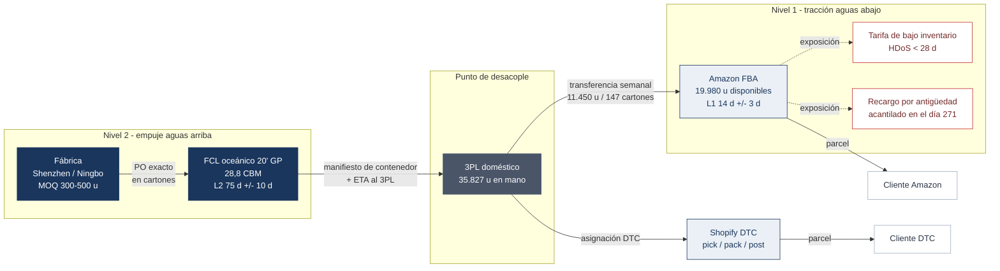
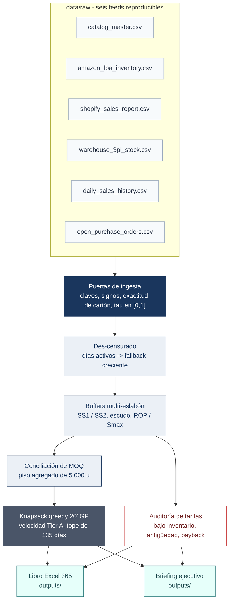

# Torre de Control de Inventario Omnicanal

*Asignación multieslabón y des-censurado de demanda para un ciclo semanal de S&OP.*

[](https://github.com/magnumjpg/omnichannel-inventory-control-tower/actions/workflows/tests.yml) [](https://github.com/magnumjpg/omnichannel-inventory-control-tower/actions/workflows/tests.yml) [](https://www.python.org/) [](LICENSE) [](#4-contrato-de-datos-sintéticos)

**Español** · [English](README.md) · [Registro de decisiones](DECISIONS.md) · [Fuentes de diagramas](assets/diagrams/README.md)

**Un motor semanal de S&OP que decide cuál es la demanda real, dónde debe estar el stock y qué envía la fábrica, con cada restricción auditable.**

*Catálogo sintético de 160 SKU · snapshot 2026-10-25 · semilla 42 · USD · un ciclo oceánico semanal en 20' GP · 65 tests*

---

## De un vistazo

- **Pregunta:** ¿cuál es la demanda real cuando los quiebres de stock censuran las ventas, cuánto inventario debe estar en FBA frente al 3PL, qué debe enviar la fábrica y qué debe removerse antes del acantilado de inventario envejecido?
- **Datos:** un catálogo sintético determinista de 160 SKU hijos en seis familias de accesorios de viaje (`seed=42`), con la tarifa de Amazon de 2026 como input de política.
- **Método:** estimación de demanda consciente de la censura, stock de seguridad en dos eslabones con escudo de tarifas, reconciliación de MOQ por SKU y contenedor, y auditoría de payback de remociones; libro Excel de seis pestañas con 8.048 fórmulas vivas.
- **Resultado:** 11.450 unidades (147 cartones) pasan de 3PL a FBA; el PO de fábrica es de 38.750 unidades (461 cartones, 26,910 CBM); el 20' GP seleccionado carga 28,770 de 28,8 CBM (99,9%) con 41.850 unidades; la exposición a tarifas a 30 días en el peor caso es de 3.442 $.
- **Advertencia:** cada transacción y saldo es sintético; las tarifas son inputs de política que deben contrastarse con la tarifa vigente de Amazon; el libro requiere Excel 365 para `LET`, `XLOOKUP` y `CEILING.MATH`.

Este repositorio implementa un motor semanal de decisiones S&OP que responde cuatro preguntas operativas con aritmética auditable:

1. **¿Cuál es la demanda real?** Las ventas están censuradas por los quiebres de stock, por lo que las unidades observadas subestiman la demanda. Un estimador consciente de la censura reconstruye la velocidad latente y se puntúa sobre nueve cortes walk-forward.
2. **¿Cuánto inventario debe estar en FBA y cuánto en el 3PL?** El stock de seguridad estocástico se reparte entre dos eslabones, con un escudo de política que mantiene FBA por encima del umbral de 28 días de la tarifa de bajo inventario de Amazon.
3. **¿Qué debe enviar la fábrica esta semana?** Los MOQ por SKU, el piso agregado de 5.000 unidades, la granularidad de cartón y el tope de 135 días de DOS se concilian antes de llenar un contenedor 20' GP.
4. **¿Qué debe removerse o rebajarse antes del acantilado de inventario envejecido?** El payback de remoción se compara con el recargo mensual por antigüedad; solo se recomiendan remociones económicamente justificadas.

La salida es un **libro Excel 365 de seis pestañas gobernado por el motor, con aritmética viva**, un briefing ejecutivo en Markdown, artefactos CSV/JSON procesados y una **suite de 65 tests de pytest** que fija la matemática y la estructura del libro.

El catálogo sintético modela una marca ficticia de organización de viaje, **Northbound Supply Co.**: packing cubes, bolsas de compresión, neceseres, organizadores tecnológicos, bolsas para calzado y bolsas de lavandería. Cada cifra es reproducible sin depender de los datos de producto de una empresa real.

## 1. Línea base ejecutiva

La corrida incluida es determinista. Estos son los KPI que produce `python main.py --run-all`:

| KPI | Línea base | Interpretación |
| :--- | ---: | :--- |
| FNSKU hijos | 160 | 6 familias padre, matriz completa tamaño × color × herraje |
| Disponible en FBA | 19.980 u | Inventario vendible en Amazon al snapshot |
| En mano en 3PL | 35.827 u | Buffer doméstico aguas arriba |
| FNSKU con HDoS < 14d | 53 | Banda operativa de quiebre; ver nota de escenarios |
| Banda de tarifa 14–28d no exenta | 8 | Ventana de 30 días; el modelo de cobro usa max(30d, 90d) |
| FNSKU en acantilado (>270d) | 2 | Stock expuesto a los tramos de $5,45+ |
| Transferencia 3PL → FBA | 11.450 u / 147 cartones | Múltiplos exactos y seguros por edad |
| PO base de fábrica | 38.750 u / 461 cartones / 26,910 CBM | Antes del top-up Tier A |
| Contenedor | FCL 20' GP · 28,770 / 28,8 CBM · 99,9% | 492 cartones / 41.850 unidades cargadas |
| MOQ agregado del PO | CUMPLIDO | ≥ 5.000 unidades |
| Exposición a tarifa (30d, peor caso) | $3.442,00 | Cota superior: todas las unidades transferidas se venden dentro de la banda |
| AIS mensual proyectado | $38,63 | Recargo por antigüedad 2026 |
| Recomendaciones de remoción | 2 | Payback ≤ 12 meses |

**Nota sobre escenarios.** El generador inyecta **exactamente 3 SKU críticos (<14d HDoS), 4 en banda de penalización (14–28d) y 2 en acantilado (>270d)** en `generation_truth.csv`. El KPI operativo “FNSKU con HDoS < 14d = 53” cuenta todos los SKU cuya posición simulada al snapshot queda bajo 14 días, incluidos SKU de cola larga que no son escenario; no es el conteo de inyección. Los conteos de inyección están fijados por `test_scenario_injection_is_exactly_three_four_two`.

## 2. Topología del sistema y flujo de datos

Dos diagramas describen el mismo sistema. El primero es la **red física multi-eslabón**: un carril de reposición largo e incierto que alimenta un punto de desacople doméstico, el cual luego sirve a Amazon FBA y Shopify DTC con lead times y regímenes de tarifas distintos. El segundo es el **contrato computacional**: seis feeds crudos, un estimador consciente de la censura, dos eslabones de planificación y los artefactos que firma un operador.

### 2.1 Topología física multi-eslabón



*Diagrama 1. La red física multi-eslabón: un carril de fábrica que se mide en meses, un punto de desacople en un 3PL doméstico y dos carriles de pull con lead times y regímenes de tarifas distintos. Exportes estáticos: [SVG](assets/diagrams/topology-es.svg) · [PNG](assets/diagrams/topology-es.png) · [Fuente Mermaid](assets/diagrams/topology-es.mmd).*

Los dos carriles corren con relojes deliberadamente distintos. El carril de fábrica es una decisión **push** tomada con un lead time medio de 75 días y una desviación de 10 días; la dominan los MOQ, la granularidad de cartón maestro y el volumen del contenedor. El carril FBA es una decisión **pull** con un lead time medio de 14 días y una desviación de 3 días; la dominan el umbral de 28 días de Amazon y el tope de 120 días de DOS post-transferencia. El 3PL se sitúa entre ambos como punto de desacople: absorbe la irregularidad de la fábrica y agrupa la demanda DTC, mientras FBA retiene solo el inventario que puede venderse antes de convertirse en pasivo de tarifas.

### 2.2 Flujo de datos y de decisión



*Diagrama 2. El contrato computacional: seis feeds crudos atraviesan las compuertas de ingesta, el des-censurado y los buffers de dos eslabones, y de ahí pasan a la reconciliación de MOQ, el empaque del contenedor y la auditoría de tarifas que alimentan el libro y el briefing. Exportes estáticos: [SVG](assets/diagrams/data-flow-es.svg) · [PNG](assets/diagrams/data-flow-es.png) · [Fuente Mermaid](assets/diagrams/data-flow-es.mmd).*

Cada número derivado en `outputs/` es reproducible a partir de los seis feeds crudos más `src/config.py`. `generation_truth.csv` queda fuera de este camino a propósito: contiene las etiquetas de escenario inyectadas solo para validación y ningún módulo de producción lo lee.

## 3. Inicio rápido

### Requisitos

- Python **3.11+**
- Excel **Microsoft 365** para abrir el libro con recálculo de `LET` / `XLOOKUP` / `CEILING.MATH`
- No se requieren servicios externos, credenciales, bases de datos ni archivo `.env`

### Instalar y ejecutar

```powershell
python -m venv .venv
.\.venv\Scripts\Activate.ps1
pip install -r requirements.txt

# Refresco semanal canónico: feeds -> motor -> briefing -> libro
python main.py --run-all

# Puerta de calidad
python -m pytest -q
```

En macOS/Linux, active con `source .venv/bin/activate` y ejecute los mismos comandos.

### Modos de CLI

| Comando | Qué hace |
| :--- | :--- |
| `python main.py --generate-data` | Regenera los seis CSV ERP crudos y `generation_truth.csv` con semilla 42 |
| `python main.py --run-pipeline` | Ejecuta des-censurado, buffers multi-eslabón, conciliación de MOQ, knapsack y auditoría de tarifas; escribe `data/processed/` |
| `python main.py --export-excel` | Reconstruye el libro de seis pestañas desde una corrida fresca |
| `python main.py --run-all` | Todo lo anterior más el briefing ejecutivo |
| `python -m src.diagnostics.estimator_backtest` | Puntúa cuatro estimadores en nueve cortes walk-forward contra la demanda latente; escribe `data/processed/estimator_backtest.csv` |
| `python main.py --help` | Referencia completa de argumentos |

`--seed` cambia la semilla del generador (por defecto 42). `--quiet` suprime el resumen de KPI en consola, pero escribe los artefactos.

### Salidas

```text
data/raw/                         seis feeds ERP reproducibles
data/processed/                   demanda, plan FBA, PO fábrica, manifiesto,
                                  auditoría de tarifas, verdad de generación,
                                  exec_summary.json, container_plan.json
outputs/
  Weekly_Operations_Replenishment_Model.xlsx   libro de firma (decisiones del motor + aritmética viva)
  Weekly_Executive_Briefing.md                 briefing ejecutivo de una página
```

## 4. Contrato de datos sintéticos

El generador produce un esquema relacional coherente. Cada feed es determinista para una semilla dada y cada clave foránea resuelve a `catalog_master.sku_id`.

| Feed | Grano | Campos clave |
| :--- | :--- | :--- |
| `catalog_master.csv` | 1 fila por FNSKU hijo | `sku_id`, `parent_sku_id`, dimensiones, `abc_xyz_tier`, especificación de cartón/MOQ, costos, `parent_stationary_share` |
| `amazon_fba_inventory.csv` | 1 fila por FNSKU al snapshot | disponible, transferencia a FC, inbound, HDoS 30/90d, cinco buckets de edad, ventas de 7d |
| `shopify_sales_report.csv` | 1 fila por línea de pedido DTC | timestamp, SKU, cantidad, precio bruto, descuento, estado de fulfillment |
| `warehouse_3pl_stock.csv` | 1 fila por FNSKU al snapshot | en mano, cartones sellados, unidades sueltas, asignación DTC |
| `daily_sales_history.csv` | 1 fila por SKU × canal × día | inventario inicial/final, ventas observadas, flag de quiebre, peso de exposición τ |
| `open_purchase_orders.csv` | 1 fila por línea de PO abierta | unidades ordenadas/abiertas, estado, modo de flete, ETA al 3PL |
| `generation_truth.csv` | solo validación | media diaria verdadera, demanda latente, flags de escenario y días objetivo |
| `demand_unconstrained.csv` | 1 fila por SKU hijo | `naive_30d`, `mu_active`, `mu_cs`, `baseline_90d`, `baseline_365d`, `mu_unconstrained` enviado, `sigma_unconstrained`, velocidades DTC y global |
| `estimator_backtest.csv` | 1 fila por corte × estimador | sesgo, WAPE, APE mediano y métricas del subconjunto agotado; lo produce el backtest de diagnóstico, el pipeline nunca lo lee |

### Parámetros de diseño

- **Historia:** 365 días; snapshot **2026-10-25**.
- **Catálogo:** 160 FNSKU hijos en 6 familias padre: P01 Aero Packing Cubes (36), P02 Vault Compression Bags (36), P03 Transit Toiletry Kits (36), P04 Grid Tech Organizers (24), P05 Cabin Shoe Bags (16), P06 Mesh Laundry Bags (12).
- **Matriz 4-D:** tamaños S/M/L en P01–P03 con **12% / 52% / 36%**; Compact/Large en P04 (60/40); Standard/Large en P05 (65/35); S/M/L en P06 (25/45/30). Seis colores con **38% / 24% / 14% / 11% / 8% / 5%** en P01–P04 y cuatro en P05–P06. Herraje: zip estándar 68% / zip resistente al agua 32% (P01–P04), cordón 68% / zip 32% (P05), cordón 100% (P06).
- **Nota sobre el mix realizado:** los tiers ABC-XYZ se asignan por ranking de participación estacionaria ponderada por familia, no re-normalizando los pesos de diseño. Por eso el mix realizado se desvía de la matriz de diseño: en las tres familias hero de packing, la talla S es **6,3%** del volumen frente al 12% diseñado, Black es **46,5%** frente al 38% y Terracotta es **1,4%** frente al 5%, mientras el invariante de Pareto (top 30 SKU = **73,5%**) se cumple exactamente. Es una decisión de modelado deliberada: la asignación por tiers es la que produce el sesgo de Pareto que el motor debe gestionar, así que el catálogo no se re-estratifica ni se regeneran KPI para alinear cosméticamente el mix.
- **Pareto:** el 18,8% superior de SKU (30) genera **73,5%** del volumen; el CV de AX/AY se mantiene en el sobre 0,22–0,45 con 14–48 unidades/día.
- **Tiers:** AX 18 · AY 12 · BX 30 · BY 20 · CZ 80.
- **Cartones maestros:** P01/P02/P04 = 100 u; P03/P05/P06 = 50 u.
- **MOQ:** P01/P02/P03/P05 = 300 u; P04/P06 = 500 u. El piso agregado del PO es 5.000 u.
- **Inyección de escenarios:** 3 críticos, 4 en banda de penalización y 2 en acantilado, etiquetados solo en `generation_truth.csv`; los flags nunca se filtran a los feeds de producción.

La capa de ingesta rechaza claves duplicadas, SKU huérfanos, inventario negativo, flags de quiebre inválidos, τ fuera de `[0,1]`, cantidades que no son múltiplos de cartón y archivos faltantes. Ver `src/data/ingestion.py`.

## 5. Especificación matemática

Todas las fórmulas están implementadas en `src/engine/`. El libro presenta las decisiones del motor y mantiene viva la aritmética (unidades, CBM, exposición, chequeos y agregados).

### 5.1 Des-censurado de demanda

Para cada canal de forma independiente (Amazon FBA y Shopify DTC), sobre una ventana móvil de 30 días. Sea $`D_i`$ la tasa de demanda diaria latente del SKU hijo $`i`$, y sea $`\tau_{it}\in[0,1]`$ la fracción del día $`t`$ en la que el SKU estuvo realmente disponible para comprar. Las ventas observadas son un proceso de conteo adelgazado,

$$
S_{it}\mid D_i \sim \mathrm{Poisson}(\tau_{it}D_i).
$$

**Nivel 1: extrapolación por días activos.** Sobre una ventana $`W`$, la log-verosimilitud es

$$
\ell(D_i)=\sum_{t\in W}\Big[S_{it}\log(\tau_{it}D_i)-\tau_{it}D_i-\log(S_{it}!)\Big],
$$

y la condición de primer orden $`\partial\ell/\partial D_i=0`$ produce

$$
\;\hat D_i^{\text{act}}=\frac{\sum_{t\in W}S_{it}}{\sum_{t\in W}\tau_{it}}\;
$$

Éste es el estimador de máxima verosimilitud de la tasa de demanda para un proceso de Poisson adelgazado. Un quiebre total aporta cero al numerador y al denominador, de modo que se excluye de la tasa en lugar de interpretarse erróneamente como demanda cero. Cada SKU-día lleva un peso de exposición

$$
\tau_{it}=
\begin{cases}
1, & I_{it}^{\text{open}}>0,\; I_{it}^{\text{close}}>0,\\
0, & I_{it}^{\text{open}}\le 0,\\
\min\!\left(1,\;\dfrac{S_{it}}{\max\!\big(S_{it},\hat D_{i,t-1}\big)+\tfrac12\hat\sigma_{i,t-1}}\right), & I_{it}^{\text{open}}>0,\; I_{it}^{\text{close}}=0.
\end{cases}
$$

La rama de quiebre parcial es un proxy acotado de supervivencia: el denominador es la demanda esperada previa más media desviación estándar, de modo que el peso cae cuanto más temprano ocurre el quiebre y nunca supera uno.

**Nivel 2: imputación transversal entre hermanos.** Cuando el SKU $`i`$ está censurado, los hermanos con stock de la misma familia padre revelan el tráfico faltante. Defina la participación activa de hermanos y su complemento inactivo

$$
\Omega_A=\sum_{j\in P\setminus\{i\}}\omega_{j\mid P}\,\mathbf{1}[j\text{ activo}],
\qquad
\Omega_I=1-\Omega_A,
$$

donde $`\omega_{j\mid P}`$ es la participación estacionaria del padre. Con el parámetro de canibalización/sustitución $`\gamma_P=0,10`$,

$$
\hat D_{it}^{\text{cs}}
=\omega_{i\mid P}\;
\frac{\sum_{j\in P\setminus\{i\}}\mathbf{1}[j\text{ activo}]\,S_{jt}}
{\Omega_A+\gamma_P\,\Omega_I}.
$$

El término $`\gamma_P\Omega_I`$ reconoce que parte del volumen observado de los hermanos es **sustitución** de hermanos no disponibles, no demanda incremental del padre. Incluirlo en el denominador evita sobre-acreditar al SKU focal. Los estimadores diarios se promedian sobre los días censurados $`C_i`$ de la ventana:

$$
\hat D_i^{\text{cs}}=\frac{1}{|C_i|}\sum_{t\in C_i}\hat D_{it}^{\text{cs}}.
$$

**Escalera de fallback: ensancha la ventana antes de extrapolar.** Un SKU totalmente agotado no aporta nada a $`\hat D_i^{\text{act}}`$: numerador y denominador son cero, así que la tasa está indefinida, no es cero. El motor ensancha la ventana de exposición en un orden fijo en lugar de extrapolar desde un mes sin información:

$$
\hat D_i=
\begin{cases}
\hat D_i^{\text{act}}(30\text{d}), & \tau_{i,30}>0,\\
\hat D_i^{\text{act}}(90\text{d}), & \tau_{i,30}=0,\ \tau_{i,90}>0,\\
\hat D_i^{\text{act}}(365\text{d}), & \tau_{i,90}=0,\ \tau_{i,365}>0,\\
\hat D_i^{\text{cs}}, & \text{en otro caso}.
\end{cases}
$$

Es el mismo estimador de máxima verosimilitud aplicado a la ventana más amplia en la que el SKU estuvo realmente a la venta. El prior de hermanas es el último recurso porque su denominador $`\Omega_A+\gamma_P\Omega_I`$ colapsa a $`\gamma_P=0.10`$ cuando toda una familia está agotada, lo que multiplica la estimación por diez aproximadamente.

**Rechazado: mezcla de credibilidad empírico-bayesiana.** La primera versión publicada contraía el estimador de días activos hacia el prior de hermanas,

$$
\hat D_i=\frac{n_i}{n_i+\kappa}\,\hat D_i^{\text{act}}+\frac{\kappa}{n_i+\kappa}\,\hat D_i^{\text{cs}},\qquad n_i=\sum_{t\in W}\tau_{it},\quad \kappa=7,
$$

la media posterior de un modelo Gamma-Poisson con fuerza previa de $`\kappa`$ pseudo-días. Se sigue calculando como columna de diagnóstico, pero no es la regla enviada.

### 5.1.1 Backtest del estimador

Cuatro candidatos se puntuaron sobre nueve cortes mensuales entre 2026-02 y el snapshot en vivo. Cada corte ve solo la historia disponible en esa fecha; el objetivo es la demanda FBA latente que el generador extrajo *antes* de que el inventario la truncase.

| Estimador | Sesgo medio | WAPE medio | Peor WAPE | WAPE en el subconjunto agotado |
| :--- | ---: | ---: | ---: | ---: |
| **Escalera enviada** | **+0,5%** | **1,1%** | **2,4%** | **39,5%** |
| Naive (ventas / 30) | −4,5% | 4,5% | 15,3% | 100,0% |
| Mezcla κ=7 | +5,8% | 7,0% | 13,3% | 318,5% |
| Solo prior de hermanas | +6,3% | 10,3% | 25,3% | 318,5% |

La tabla cierra tres discusiones. El naive no es competitivo: cuenta un día de quiebre como un día de ventas cero, y el daño escala con la censura, de 1,1% frente a 1,2% en el corte menos censurado a 15,3% frente a 2,4% en el snapshot. La mezcla κ=7 también pierde, y pierde justo en los SKU que motivan el módulo: 318% de WAPE en el subconjunto agotado, porque entrega un SKU totalmente agotado al prior de hermanas, que multiplica por diez cuando la familia está oscura. La escalera es lo que arregla ese subconjunto, de 318% a 39%.

Reproducible con `python -m src.diagnostics.estimator_backtest`; la tabla por corte está en `data/processed/estimator_backtest.csv` y la nota en `outputs/estimator_backtest.md`.

**Léelo como el mejor caso.** El objetivo no tiene error de muestreo porque es la extracción latente del propio simulador. Es un test de recuperación contra un proceso generador conocido, no un backtest de previsión fuera de muestra; en producción el objetivo sería más ruidoso y la brecha entre los cuatro candidatos, mayor. Lo que se traslada es el ranking, no el WAPE absoluto.

La volatilidad se estima solo con días activos no censurados y luego se recorta al sobre de CV publicado del tier $`(\ell_t,u_t)`$:

$$
\hat\sigma_i=\min\!\Big[\max\!\big(s_i,\;\mathrm{clip}(\mathrm{CV}_i^{\text{prior}},\ell_t,u_t)\,\hat D_i\big),\;\;u_t\,\hat D_i\Big],
$$

donde $`s_i`$ es la desviación estándar muestral de las ventas en días activos. Los ceros censurados se excluyen a propósito: un quiebre es una cota inferior de la demanda, no evidencia de colapso. La velocidad y la varianza global combinan los canales bajo independencia:

$$
\hat D_i^{\text{global}}=\hat D_i^{\text{FBA}}+\hat D_i^{\text{DTC}},
\qquad
\hat\sigma_i^{\text{global}}=\sqrt{\big(\hat\sigma_i^{\text{FBA}}\big)^2+\big(\hat\sigma_i^{\text{DTC}}\big)^2}.
$$

El módulo también expone la esperanza Tobit Tipo I y el ratio inverso de Mills para auditoría/investigación:

$$
\mathbb{E}[D^\star\mid D^\star\ge I]=\mu+\sigma\,\lambda\!\left(\frac{I-\mu}{\sigma}\right),
\qquad
\lambda(z)=\frac{\phi(z)}{1-\Phi(z)}.
$$

### 5.2 Buffers multi-eslabón y escudo de política

**Convolución de varianza.** Sea la demanda diaria $`D_t`$ i.i.d. con media $`\bar D`$ y varianza $`\sigma_D^2`$, y sea el lead time $`L`$ independiente con media $`\bar L`$ y varianza $`\sigma_L^2`$. La demanda durante el lead time es

$$
X=\sum_{t=1}^{L}D_t .
$$

Condicionado a $`L`$, $`\mathbb{E}[X\mid L]=\bar D L`$ y $`\mathrm{Var}(X\mid L)=L\sigma_D^2`$. La ley de varianza total da

$$
\mathrm{Var}(X)
=\underbrace{\mathbb{E}\big[\mathrm{Var}(X\mid L)\big]}_{\text{ruido de demanda}}
+\underbrace{\mathrm{Var}\big(\mathbb{E}[X\mid L]\big)}_{\text{ruido de lead time}}
=\bar L\,\sigma_D^2+\bar D^2\,\sigma_L^2 .
$$

Por lo tanto,

$$
\;\sigma_{DL,k}^2=\bar L_k\,\sigma_D^2+\bar D^2\,\sigma_{L,k}^2,\qquad SS_k=z_\alpha\,\sigma_{DL,k}\;
$$

con $`L_1=14`$ d / $`\sigma_{L_1}=3`$ d (3PL → FBA) y $`L_2=75`$ d / $`\sigma_{L_2}=10`$ d (fábrica → 3PL). Los niveles de servicio son AX 98% ($`z=2,054`$), AY 97% (1,881), BX/BY 95% (1,645), CZ 90% (1,282). La fracción de varianza atribuible al lead time es

$$
\rho_k=\frac{\bar D^2\sigma_{L,k}^2}{\bar L_k\sigma_D^2+\bar D^2\sigma_{L,k}^2},
$$

que es la cantidad que la suite verifica como $`>0,85`$ para AX en L1 y $`>0,93`$ en L2. Esa dominancia es la razón matemática por la que el motor invierte en **control del lead time**, no solo en buffers más grandes.

**Escudo de política.** Amazon aplica la tarifa de bajo inventario 2026 cuando el HDoS efectivo cae bajo 28 días. Para SKU héroe no exentos (al menos 20 unidades en la semana móvil), el buffer FBA se eleva a

$$
\;B_{\text{FBA}}=\max\!\big(SS_1,\;32\,\bar D_{\text{FBA}}\big)\;
$$

Los 32 días son el umbral de 28 días más un colchón operativo de 4 días, de modo que un shock normal de demanda de lunes a lunes no puede empujar al SKU a la banda de penalización antes de que aterrice la siguiente transferencia. Para SKU exentos o de bajo volumen, $`B_{\text{FBA}}=SS_1`$.

**Políticas de reposición.**

$$
\begin{aligned}
ROP_1 &= \bar D_{\text{FBA}}\,\bar L_1 + B_{\text{FBA}},\\
Smax_1 &= \bar D_{\text{FBA}}\,(\bar L_1 + 21) + B_{\text{FBA}},\\
ROP_2 &= \bar D_{\text{global}}\,\bar L_2 + SS_2 + B_{\text{FBA}},\\
Smax_2 &= \bar D_{\text{global}}\,(\bar L_2 + 45) + SS_2 + B_{\text{FBA}}.
\end{aligned}
$$

**Redondeo de cartón maestro seguro por edad.** Una transferencia de $`q`$ cartones maestros lleva el stock FBA de $`IP_{\text{FBA}}`$ a $`IP_{\text{FBA}}+qM`$. El objetivo redondeado es

$$
q^\star=
\begin{cases}
M\left\lceil\dfrac{\max(0,\,Smax_1-IP_{\text{FBA}})}{M}\right\rceil, & IP_{\text{FBA}}+M\left\lceil\dfrac{\max(0,\,Smax_1-IP_{\text{FBA}})}{M}\right\rceil \le 120\,\bar D_{\text{FBA}},\\
M\left\lfloor\dfrac{120\,\bar D_{\text{FBA}}-IP_{\text{FBA}}}{M}\right\rfloor, & \text{en caso contrario},
\end{cases}
$$

y la orden ejecutable se recorta además por lo que el 3PL posee físicamente:

$$
q^{\text{exec}}=\min\!\left(q^\star,\;\left\lfloor\frac{OH_{\text{3PL}}}{M}\right\rfloor\right).
$$

Redondear **hacia arriba** captura el beneficio de servicio de un cartón completo; redondear **hacia abajo** es el respaldo que garantiza que el tope de 120 días post-transferencia nunca se vulnere. Por eso el plan de transferencia es exacto en cartones y seguro por edad al mismo tiempo.

### 5.3 MOQ de fábrica y knapsack de contenedor

**Conciliación de MOQ por SKU.** Para cada SKU disparado, sea $`M_i`$ la cantidad de unidades por cartón maestro e $`IP_i^{sys}=IP_{\text{FBA}}+OH_{\text{3PL}}-Allocated_{\text{DTC}}`$. El déficit bruto y el conteo de cartones sin restricción son

$$
\Delta_i=\max\!\big(0,\;Smax_{2,i}-IP_i^{sys}\big),
\qquad
q_i^{\text{raw}}=\left\lceil\frac{\Delta_i}{M_i}\right\rceil .
$$

El piso del proveedor es $`q_i^{MOQ}=\lceil MOQ_i/M_i\rceil`$, y el tope de 135 días implica

$$
q_i^{\text{cap}}=\left\lfloor\frac{135\,\bar D_i-IP_i^{sys}}{M_i}\right\rfloor .
$$

Por lo tanto, el número de cartones ordenado es

$$
q_i=
\begin{cases}
\max\!\big(q_i^{MOQ},\;\min(q_i^{\text{raw}},q_i^{\text{cap}})\big), & q_i^{\text{cap}}\ge q_i^{MOQ},\\
q_i^{MOQ}\quad (\text{MOQ OVERRIDE}), & q_i^{\text{cap}} \lt q_i^{MOQ}.
\end{cases}
$$

La rama de override es deliberada. El MOQ del proveedor es una restricción **física**; el tope de DOS es una restricción de **planificación**. Cuando chocan, gana la restricción física, pero la violación se muestra en lugar de ocultarse.

**Piso agregado del PO.** La orden se eleva luego al MOQ agregado de 5.000 unidades,

$$
\sum_i q_i M_i\ \ge\ 5{.}000,
$$

adelantando los SKU más cercanos a quiebre en incrementos exactos de MOQ por SKU. Si el volumen semanal bruto excede 28,8 CBM, se cargan primero los cartones más urgentes (menor days-to-breach, luego mayor velocidad) y el remanente se difiere explícitamente al siguiente ciclo de lunes.

**Selección de contenedor.** `<15 CBM` → LCL, `15–28,8 CBM` → un 20' GP, `28,8–70 CBM` → un 40' HC, más de 70 CBM → múltiples 40' HC. Para un 20' GP la base se recorta para dejar 1,8 CBM de reserva; luego la capacidad restante se asigna con un **knapsack entero greedy sobre SKU Tier A**.

**Objetivo.** Para cada candidato Tier A $`i`$, defina el margen bruto unitario antes del referral de Amazon y la velocidad de beneficio por cartón

$$
GM_i=P_i^{\text{retail}}-c_i^{\text{landed}}-0{,}15\,P_i^{\text{retail}},
\qquad
\pi_i=\frac{\bar D_i\,GM_i}{v_i^{\text{carton}}}.
$$

El top-up resuelve

$$
\begin{aligned}
\max_{x_i}\quad & \sum_{i\in A}\pi_i\,x_i\\
\text{s.a.}\quad
& \sum_{i\in A} x_i\,v_i^{\text{carton}} \le C-\sum_j q_j\,v_j^{\text{carton}},\\
& IP_i^{sys}+(q_i+x_i)M_i \le 135\,\bar D_i,\\
& x_i\in\mathbb{Z}_{\ge 0},\\
& x_i=0\ \text{o}\ x_i\ge \left\lceil MOQ_i/M_i\right\rceil \quad\text{para líneas nuevas,}
\end{aligned}
$$

donde $`C\in\{28{,}8,\,70{,}0\}`$ CBM. Como cada cartón de un SKU dado tiene volumen y beneficio idénticos, $`x_i`$ se asigna greedy en $`\pi_i`$ descendente hasta que se agote la capacidad o se active el tope de DOS. La regla greedy es exacta para la relajación **fraccionaria**; sobre enteros es una heurística acotada cuya brecha máxima es un cartón por SKU. Nunca se emiten cartones fraccionarios ni cargas por encima de capacidad. La corrida base llena el 20' GP a **28,770 / 28,8 CBM (99,9%)** con 492 cartones y 41.850 unidades.

### 5.4 Auditoría de riesgo de tarifas

**Tarifa de bajo inventario (2026).** El HDoS efectivo es el peor de las dos ventanas publicadas,

$$
h_i^{\text{eff}}=\max\!\big(h_i^{30},h_i^{90}\big),
$$

y el recargo por unidad es una función por tramos de ese HDoS efectivo:

$$
f_i=
\begin{cases}
0{,}89, & h_i^{\text{eff}} \lt 14,\\
0{,}63, & 14\le h_i^{\text{eff}} \lt 21,\\
0{,}32, & 21\le h_i^{\text{eff}} \lt 28,\\
0{,}00, & h_i^{\text{eff}}\ge 28,
\end{cases}
\qquad
f_i=0\ \text{si está exento o }w_i \lt 20.
$$

La exposición a 30 días que registra el motor es

$$
E=\sum_i f_i\,q_i^{\text{exec}}M_i,
$$

que en la línea base es **$3.442,00**. Es una exposición sobre las unidades que se están transfiriendo, no un pronóstico de la factura real; Amazon factura el libro de Seller Central a nivel FNSKU.

**Recargo por inventario envejecido (2026).** Nueve tramos mensuales: $0 hasta 180 días; $0,50 / $1,00 / $1,50 para 181–270 días; **$5,45 en el acantilado de 271–300 días**; $5,70 / $5,90 hasta 365 días; $6,90 con piso de $0,30/unidad para 366–455 días; $7,90 con piso de $0,35/unidad para 456+ días. Para un FNSKU con unidades $`u_{ib}`$ en el bucket de edad $`b`$ y volumen unitario $`\nu_i`$,

$$
AIS_i=\sum_b u_{ib}\,\nu_i\,r_b
\quad\text{con}\quad
AIS_{i,b}=\max\!\big(u_{ib}\nu_i r_b,\;u_{ib}\phi_b\big)\ \text{para tramos con piso,}
$$

donde $`r_b`$ es la tarifa volumétrica mensual y $`\phi_b`$ el piso por unidad. La línea base proyecta **$38,63/mes**.

**Decisión de remoción.** La remoción cuesta $0,84/unidad, por lo que el payback contra el recargo proyectado es

$$
\tau_i^{\text{payback}}=\frac{0{,}84\,u_i}{\widehat{AIS}_i}.
$$

`EXECUTE REMOVAL` cuando $`\tau_i^{\text{payback}}\le 12`$ meses; en caso contrario, la línea se etiqueta `DISCOUNT 25% NOW` para liquidar el stock antes del siguiente snapshot del día 15 en lugar de pagar una remoción no económica. La línea base produce **2 recomendaciones de remoción**.

## 6. Unit economics: FBA sano vs FBA penalizado vs Shopify DTC

La política de inventario solo es defendible si está conectada con el margen de contribución. La tabla valora una unidad del producto insignia **P01 Aero Packing Cube** (MSRP \$40,00, FOB \$4,20, landed \$5,15) en tres estados operativos: FBA con días de suministro sanos, FBA dentro de la banda de penalización <14 días, y Shopify DTC despachado desde el 3PL.

| Línea del P&L unitario | FBA sano | FBA penalizado (<14d) | Shopify DTC |
| :--- | ---: | ---: | ---: |
| Precio de venta bruto (MSRP) | \$40,00 | \$40,00 | \$40,00 |
| Descuento promocional / bienvenida | \$0,00 | \$0,00 | −\$2,00 (5,0%) |
| **Ingreso neto realizado** | **\$40,00** | **\$40,00** | **\$38,00** |
| Costo FOB de fábrica | −\$4,20 | −\$4,20 | −\$4,20 |
| Flete oceánico, arancel, putaway 3PL | −\$0,95 | −\$0,95 | −\$0,95 |
| Transferencia LTL entrante a FBA | −\$0,45 | −\$0,45 | - |
| **Margen bruto tras COGS landed y entrada FBA** | **\$34,40** | **\$34,40** | **\$32,85** |
| Referral / comisión de pago | −\$6,00 (15%) | −\$6,00 (15%) | −\$1,40 (2,9% + \$0,30) |
| Pick, pack y fulfillment de salida | −\$3,15 (FBA small standard) | −\$3,15 (FBA small standard) | −\$6,20 (pick 3PL \$1,65 + franqueo \$4,55) |
| **Tarifa de bajo inventario** | \$0,00 | **−\$0,89** | N/A |
| Almacenaje mensual y recargo por antigüedad | −\$0,02 | −\$0,01 | −\$0,01 |
| Devoluciones y merma | −\$1,35 (8,8%) | −\$1,35 (8,8%) | −\$0,95 (6,2%) |
| Medios pagados / adquisición de cliente | −\$4,80 (12% TACoS) | −\$4,80 (12% TACoS) | −\$11,50 (CPA paid social) |
| **Beneficio de contribución neto por unidad** | **\$19,08** | **\$18,20** | **\$12,79** |
| **Margen de contribución** | **47,7%** | **45,5%** | **33,7%** |

**Registro de supuestos: qué es constante de política y qué es benchmark.**

- **De `src/config.py`:** referral de Amazon **15%** (`AMAZON_REFERRAL_RATE`), recargo de bajo inventario **\$0,89** a <14 días (`LOW_INVENTORY_FEE_US`), descuento de bienvenida DTC **5%** (`DTC_WELCOME_DISCOUNT`), comisión de pago DTC **2,9% + \$0,30** (`DTC_PAYMENT_FEE_RATE`, `DTC_PAYMENT_FIXED_FEE`). La tarifa es cero en el estado sano porque el HDoS efectivo está en o por encima de 28 días.
- **Del dossier de investigación, no de una constante de config:** fulfillment FBA **\$3,15/unidad** (small standard, ≤4 oz) y pick-and-post 3PL **\$6,20/unidad** (\$1,65 pick + \$4,55 franqueo). Son las dos únicas líneas de fulfillment que no están en `src/config.py`; se mantienen constantes entre los estados FBA para que la comparación aísle la **política de plataforma**, no la negociación con proveedores. El dossier de investigación subyacente se mantiene privado y no forma parte de este repositorio.
- **Otros benchmarks del dossier:** almacenaje/antigüedad \$0,02, \$0,01 y \$0,01; devoluciones 8,8%, 8,8% y 6,2%; adquisición 12% TACoS, 12% TACoS y un CPA de \$11,50. Son supuestos explícitos, no datos auditados.
- **Alcance:** contribución unitaria antes de overhead fijo, depreciación, FX y nómina corporativa. Se usa P01 porque es la familia de mayor volumen; otras familias tienen retail y landed distintos y moverían los niveles, no el ranking. Todos los porcentajes son sobre el MSRP bruto salvo el margen DTC, que se expresa sobre el ingreso neto realizado de \$38,00.

**Cómo leer el resultado.** Una semana dentro de la banda <14 días cuesta **\$0,88 por unidad**, o **4,6% de la contribución sana**; exactamente por eso la exposición de transferencia de esta semana es **\$3.442,00**. Ese es el valor económico del escudo de 32 días. Shopify DTC gana **\$6,29 menos por unidad** que FBA sano, pero la brecha no la causa solo el fulfillment: los medios pagados son **\$6,70 más altos** y el franqueo 3PL es **\$3,05 más alto**, compensados en parte por la ausencia del referral de 15%. Por lo tanto, DTC es una **decisión de mix de margen y propiedad del cliente**, mientras que el escudo FBA es **un seguro barato contra una penalización conocida y fechada**. El motor optimiza lo segundo; lo primero pertenece a la estrategia comercial.

## 7. Libro Excel de firma

`outputs/Weekly_Operations_Replenishment_Model.xlsx` contiene seis pestañas, cinco tablas de Excel, 21 controles de política con nombre y **8.048 fórmulas vivas** (Excel informa 8.070 porque cuatro rangos combinados heredan la fórmula de su celda ancla). El motor de Python es la única fuente de verdad para las decisiones de política: demanda no censurada, stock de seguridad, escudos de tarifa, ROP/S_max, objetivos de cartones seguros por edad y la asignación del contenedor se escriben como salidas del motor. El libro mantiene auditable la aritmética: unidades, CBM, exposición a tarifas, alertas, chequeos de MOQ/DOS y todos los agregados de KPI son fórmulas vivas sobre esas decisiones.

| Pestaña | Propósito | Fórmulas vivas representativas |
| :--- | :--- | :--- |
| `00_Exec_Control_Tower` | Cockpit de KPI, chequeos de integridad, registro de riesgos, control de aprobación | `COUNTA(tbl_Catalog[sku_id])`, `SUM`, `COUNTIF`, `CBM_20GP` |
| `01_Catalog_&_Parameters` | Catálogo de 160 SKU y controles de política (`B3:B12`, `F3:F12`) | Rangos con nombre que alimentan todo el libro |
| `02_Demand_Unconstraining` | Velocidad naive vs días activos vs hermanos vs pool de fallback, σ, uplift | Tasas naive y DTC en `G5`/`O5`, uplift y exposición en `T5:X5`; `K5` es la velocidad enviada por el motor (escalera `H5` → `Y5` → `J5`) |
| `03_FBA_Nivel1_Transfer` | SS₁, escudo, ROP/Smax, transferencia segura por edad, exposición a tarifa | Transferencia `MIN(R5,Q5) × carton_qty` en `S5`; exposición `Z5`; chequeo de cartón `AB5` |
| `04_Factory_Nivel2_PO_&_CBM` | SS₂, ROP₂/Smax₂, conciliación de MOQ, top-up, CBM y estado | `LET` + `CEILING.MATH` en `P5`; estado `DOS_Cap` en `Z5` |
| `05_Fee_Risk_Audit` | Exposición a tarifas de bajo inventario y antigüedad, payback, recomendación | `AIS_Payback` en `S5`; `EXECUTE REMOVAL` / `DISCOUNT 25% NOW` |

Los controles incluyen `L1_Mean`, `L1_Std`, `L2_Mean`, `L2_Std`, `Shield_Days`, `Age_Cap`, `CBM_20GP`, `CBM_40HC`, `DOS_Cap`, `Kappa_Cred`, `Gamma_Cannib`, `Fee_Threshold`, `Removal_Fee`, `AIS_Payback`, `Aggregate_MOQ`, `TopUp_Reserve` y `Snapshot_Date`.

El libro se guarda con `fullCalcOnLoad = True` y `forceFullCalc = True`. Las celdas de fórmula no tienen valores cacheados, por lo que **Excel las recalcula al abrir**; un visor que no calcule puede mostrar celdas vacías hasta que eso ocurra. Las funciones futuras de Excel se almacenan con el prefijo `_xlfn.` requerido, y los parámetros de `LET` llevan además el marcador `_xlpm.` de Excel.

El recálculo nativo no forma parte de CI porque requiere una instalación de Excel de escritorio. Aun así se verificó manualmente en **Excel 16.0 (build 20527)** vía COM: el libro abre sin reparación, las 8.048 fórmulas sobreviven a un ciclo de apertura/guardado, el cockpit de KPI resuelve las mismas cifras que el motor (53 / 8 / \$3.442 / 147 / 11.450) y `LET` / `XLOOKUP` / `CEILING.MATH` devuelven valores. En CI, las 8.048 fórmulas se parsean con la librería `formulas` tras normalizar las referencias estructuradas de tabla; la suite también verifica funciones requeridas, integridad de tablas/columnas, alineación de SKU, formato condicional y controles de aprobación.

## 8. Estructura del repositorio

```text
.
├── main.py                          punto de entrada CLI
├── DECISIONS.md                     registro de decisiones: alternativas y su coste
├── requirements.txt                 dependencias fijadas de runtime y test
├── LICENSE                          MIT
├── .gitignore                       cachés de Python, entorno local, secretos
├── src/
│   ├── config.py                    constantes de política, tarifas 2026, carriles
│   ├── data/
│   │   ├── generator.py             feeds deterministas, matriz 4-D, escenarios
│   │   ├── ingestion.py             loaders tipados + puertas de integridad referencial
│   │   └── database.py              tablas 3NF y vistas de auditoría en DuckDB
│   ├── engine/
│   │   ├── unconstraining.py        τ, imputación de hermanos, escala de ventanas, Tobit
│   │   ├── multiechelon.py          varianza, SS₁/SS₂, escudo, ROP, cartonización
│   │   ├── container_knapsack.py    conciliación MOQ, PO fábrica, knapsack FCL
│   │   ├── fee_audit.py             auditoría de tarifas y payback
│   │   └── pipeline.py              orquestación y KPI de resumen
│   └── deliverables/
│       ├── excel_generator.py       libro de seis pestañas: decisiones del motor + aritmética viva
│       └── briefing_report.py       briefing ejecutivo en Markdown
├── tests/                           65 tests de datos, motor, ingesta, knapsack, Excel, CLI y regresiones
├── data/raw/                        seis feeds ERP generados
├── data/processed/                  salidas del motor, tabla de verdad, resúmenes JSON
├── outputs/                         libro + briefing
└── assets/diagrams/                 exportes SVG + PNG y sus fuentes .mmd
```

### Uso como librería

El motor se puede importar sin la CLI:

```python
from src.engine.pipeline import run_pipeline
from src.deliverables.excel_generator import build_workbook

result = run_pipeline(persist=True)
build_workbook(result=result)

print(result["summary"]["fee_exposure_usd"])
```

Para materializar el almacén relacional:

```python
from src.data.database import build_database
build_database()   # -> data/processed/control_tower.duckdb
```

## 9. Reproducibilidad y pruebas

> **Antes de abrir el libro fuera de Excel.** El `.xlsx` se guarda con `fullCalcOnLoad`, así que Excel 365 (escritorio) recalcula sus 8.048 fórmulas vivas al abrirlo. Las celdas de fórmula no llevan valores cacheados: Google Sheets, la vista previa de GitHub, QuickLook de macOS o cualquier visor que no calcule pueden mostrar celdas vacías o funciones `_xlfn.` sin resolver. Para una lectura independiente del visor, use `outputs/Weekly_Executive_Briefing.md` y los CSV/JSON de `data/processed/`; llevan los mismos KPI.

- **Semilla:** 42 (`config.SEED`); corridas repetidas de `--generate-data` son idénticas byte a byte.
- **Snapshot:** fijo en 2026-10-25 para que todos los artefactos y tests sean estables.
- **Aislamiento de tests:** pytest genera feeds, salidas y libro en un directorio temporal; nunca modifica `data/` ni `outputs/` del repositorio.
- **Suite:** **65 passed** en Python 3.11.9 con pandas 2.3.2, NumPy 2.3.3, openpyxl 3.1.5, formulas 1.3.4, DuckDB 2.0.0 y pytest 8.4.2.

Cobertura destacada:

- catálogo determinista, participaciones 4-D, sobres Pareto/tier, exactamente 3/4/2 escenarios;
- identidad de ingesta `apertura − ventas = cierre`, rechazo de huérfanos, PO exactos en cartones;
- primitivas de des-censurado, recuperación de escenarios críticos, pisos/techos de σ, reproducibilidad;
- descomposición de varianza y dominancia del lead time (>0,85 para AX en L1, >0,93 en L2);
- bandas de tarifa, acantilados de antigüedad y pisos por unidad, reconciliación de la auditoría;
- MOQ por SKU, piso agregado del PO, tope de 135 días, múltiplos de cartón, llenado ≤28,8 CBM, ranking greedy Tier A;
- pestañas, tablas, controles con nombre, población de fórmulas, parseabilidad, control de aprobación;
- los cuatro flujos de CLI.

Ejecute un subconjunto con, por ejemplo:

```powershell
python -m pytest tests/test_engine.py -q
python -m pytest tests/test_excel_workbook.py -q
```

## 10. Supuestos y límites

- **Telemetría sintética, aritmética real.** Los feeds son generados, no un libro contable auditado. El valor está en la lógica de decisión, las restricciones y la reproducibilidad, no en pretender un P&L real.
- **Un 3PL, un carril de fábrica, USD, cadencia oceánica semanal.** Multi-almacén, multi-moneda y optimización de flete aéreo quedan fuera de alcance.
- **Las tarifas son insumos de política.** La tabla 2026 de Amazon está centralizada en `src/config.py`; verifique las tarifas publicadas vigentes antes de usarla en producción.
- **Los unit economics son un benchmark, no un P&L auditado.** La comparación sano/penalizado/DTC de la sección 6 combina constantes de política de config con supuestos de fulfillment, devoluciones y adquisición del dossier de investigación; excluye overhead fijo, depreciación y FX.
- **El libro es un artefacto de Excel 365.** `LET`, `XLOOKUP` y `CEILING.MATH` requieren una versión moderna de Excel. Los visores estáticos no lo calculan.
- **Sin conectores ERP/Amazon/Shopify en vivo.** El contrato CSV imita la forma de producción para poder dejar exports en `data/raw/`; autenticación y paginación de API quedan deliberadamente fuera.
- **El recálculo nativo de Excel no se ejecuta en CI.** Se validó manualmente en Excel 16.0 vía COM; se prueban la gramática y la estructura de las fórmulas, y el motor Python determinista es la fuente numérica de verdad.
- **Conteos de escenario vs. conteos operativos.** Se inyectan y etiquetan exactamente 3/4/2 casos de estrés; el KPI “HDoS < 14d” es un conteo operativo de toda la flota y puede ser mayor.

## 11. Documentación

Este README es el documento operativo. La especificación del motor vive en `src/engine/`, el esquema del libro en `src/deliverables/excel_generator.py` y las constantes de política en `src/config.py`. El razonamiento detrás de las decisiones (y las alternativas descartadas) está en [`DECISIONS.md`](DECISIONS.md). Las fuentes y exportes estáticos de los diagramas están en [`assets/diagrams/`](assets/diagrams/README.md). Las notas internas de trabajo y el dossier de investigación se mantienen privados y no forman parte de este repositorio.

## Licencia

MIT. Ver [LICENSE](LICENSE).

## Autor

Jaime Pérez Gómez. [GitHub](https://github.com/magnumjpg) · [LinkedIn](https://www.linkedin.com/in/jaime-p%C3%A9rez-656919237/) · [jaimeperezgms@gmail.com](mailto:jaimeperezgms@gmail.com)

---

**Hecho para operadores, no para dashboards.** Cambie una celda de política, recalcule y el plan se mueve, con todas las restricciones todavía visibles.
