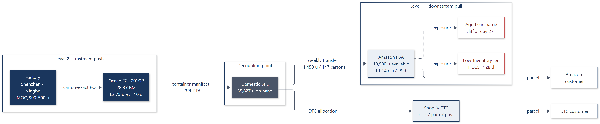
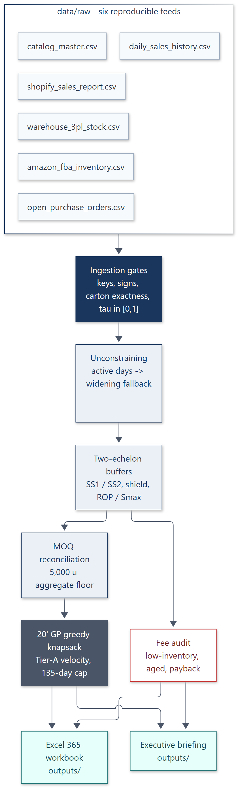
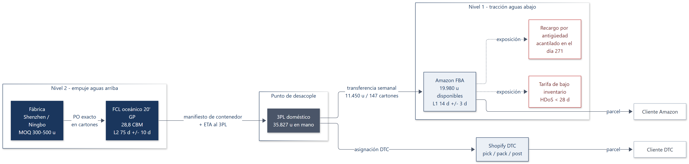
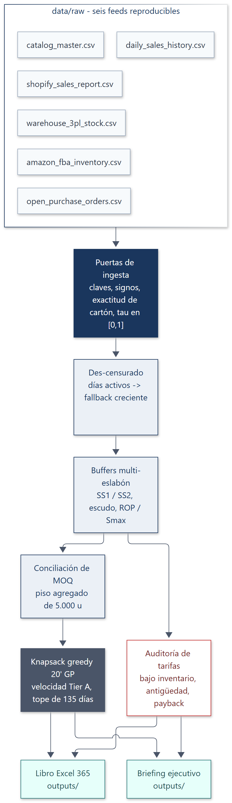

# Static diagram exports

Rendered artifacts for the two diagrams in [`README.md`](../../README.md) and
[`README_ES.md`](../../README_ES.md). GitHub renders Mermaid natively, but the SVG and PNG
files here are the frozen, byte-stable versions used in slides, PDFs and the portfolio site.

| Diagram | Language | Source | Vector | Raster |
| --- | --- | --- | --- | --- |
| Physical multi-echelon topology | EN | [`topology-en.mmd`](topology-en.mmd) | [`topology-en.svg`](topology-en.svg) | [`topology-en.png`](topology-en.png) |
| Data and decision flow | EN | [`data-flow-en.mmd`](data-flow-en.mmd) | [`data-flow-en.svg`](data-flow-en.svg) | [`data-flow-en.png`](data-flow-en.png) |
| Physical multi-echelon topology | ES | [`topology-es.mmd`](topology-es.mmd) | [`topology-es.svg`](topology-es.svg) | [`topology-es.png`](topology-es.png) |
| Data and decision flow | ES | [`data-flow-es.mmd`](data-flow-es.mmd) | [`data-flow-es.svg`](data-flow-es.svg) | [`data-flow-es.png`](data-flow-es.png) |

## Palette

The `classDef` blocks in each source map the diagrams onto the same corporate palette used by
the workbook and the briefing: navy for upstream push, slate for the decoupling point, pale
blue for downstream pull, red for fee exposure, and teal for signed outputs.

| Role | Fill | Stroke | Text |
| --- | --- | --- | --- |
| Upstream / gate | `#1A365D` | `#1A365D` | `#FFFFFF` |
| Decoupling / packing | `#4A5568` | `#4A5568` | `#FFFFFF` |
| Downstream / engine | `#EBF0F6` | `#1A365D` | `#1A365D` |
| Raw feed | `#F7FAFC` | `#A0AEC0` | `#2D3748` |
| Fee exposure | `#FFFFFF` | `#C53030` | `#742A2A` |
| Signed output | `#E6FFFA` | `#2C7A7B` | `#234E52` |

## Preview

**Physical multi-echelon topology (EN)**



**Data and decision flow (EN)**



**Physical multi-echelon topology (ES)**



**Data and decision flow (ES)**



## How these were generated

The `.mmd` files are extracted verbatim from the two READMEs, so the README and the exported
artifacts cannot drift apart. Rendering uses `mermaid-cli` 12.0.0 with
[`mermaid-config.json`](mermaid-config.json) (base theme, Segoe UI, slate connector lines) and a
Puppeteer config that points at a local Chrome install.

```bash
mmdc -p puppeteer-config.json -c mermaid-config.json -b white \
     -i topology-en.mmd -o topology-en.svg
mmdc -p puppeteer-config.json -c mermaid-config.json -b white -s 2 \
     -i topology-en.mmd -o topology-en.png
```

`-s 2` renders the PNG at twice the CSS resolution for retina screens and print. The SVG files
are the canonical exports: they stay crisp at any zoom and keep the text selectable.
